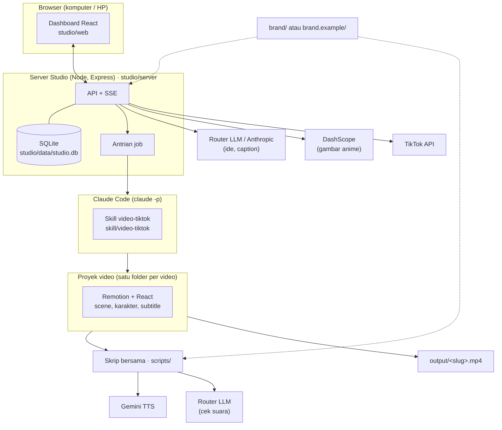
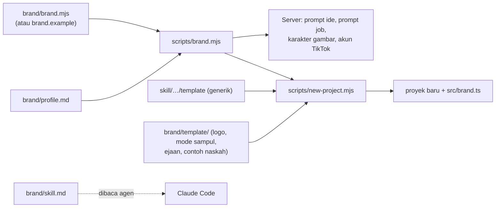

# Arsitektur

## Gambaran



Tiga bagian utama:

1. **Studio** (`studio/`): dashboard React + server Express. Menyimpan ide, video, media, job, dan pengaturan di SQLite; memanggil model AI untuk ide dan caption; membuat gambar anime; mengirim ke TikTok; menjalankan job Claude Code satu per satu.
2. **Skill `video-tiktok`** (`skill/video-tiktok/`): instruksi untuk Claude Code (gaya rumah, langkah kerja, aturan FYP, QA) plus **template proyek Remotion**. Setiap job video membuat proyek baru dari template ini.
3. **Proyek video** (`<slug>/` di folder repo): sumber satu video (naskah `src/script.json`, scene React, suara per scene). Proyek tidak punya `node_modules` sendiri dan memanggil **skrip bersama** (`scripts/`) lewat `npm run`.

Semua yang khusus brand ada di **`brand/`** (lihat [brand.md](brand.md)).

## Struktur folder

```
Studio-Konten/
├── README.md, LICENSE, docs/          dokumentasi
├── .env.example                       contoh kunci API (salin ke .env, tidak ikut git)
├── Studio Konten.command              launcher macOS (klik dua kali)
├── package.json                       dependensi bersama semua proyek video (Remotion, React, TS, Three.js)
├── brand.example/                     brand contoh fiktif: brand.mjs, profile.md, skill.md
├── brand/                             brand kamu sendiri (tidak ikut git)
├── scripts/                           skrip bersama: brand, proyek baru, suara, cek, QA, render
├── skill/video-tiktok/
│   ├── SKILL.md                       instruksi Claude Code
│   ├── references/                    contoh naskah dan scene
│   └── assets/template/               template proyek Remotion
├── studio/
│   ├── server/                        backend Node
│   ├── web/                           sumber dashboard React (Vite)
│   ├── public-pages/                  halaman privasi/ketentuan/callback untuk aplikasi TikTok
│   ├── dist/                          hasil build dashboard (tidak ikut git)
│   └── data/                          database, PIN, hasil job (tidak ikut git)
├── media/                             upload dan gambar AI (tidak ikut git)
├── output/                            semua MP4 final (tidak ikut git)
└── <slug>/                            satu proyek video (tidak ikut git)
```

`.gitignore` memakai **daftar putih**: hanya file di atas yang ditandai sebagai bagian repo yang dilacak; folder proyek video, `media/`, `output/`, `brand/`, dan data lokal tidak pernah ikut.

## Server (`studio/server/`)

Express 5 di port `4321` (env `PORT`), mendengarkan di `0.0.0.0` supaya bisa dibuka dari HP.

| Modul | Isi |
|---|---|
| `index.mjs` | Aplikasi Express: autentikasi PIN, semua route API, upload (Multer), Server-Sent Events, penyaji `/files` dan dashboard |
| `config.mjs` | Path (`ROOT`, `MEDIA`, `OUTPUT`, `DATA`, `RESULTS`), membaca `.env`, PIN, alamat LAN |
| `db.mjs` | SQLite lewat `node:sqlite` (mode WAL), skema, migrasi kolom, helper `all/get/run/setting` |
| `seed.mjs` | Isi awal database baru: profil brand dari `brand/profile.md` |
| `content.mjs` | Pilar dan bentuk konten, rencana ide, prompt sistem ide (`IDEA_SYSTEM`), bagian profil brand |
| `llm.mjs` | `chatJson()`: mencoba daftar model berurutan; `anthropic:<id>` lewat SDK Anthropic (streaming), lainnya ke router OpenAI-compatible; `listModels()` untuk dropdown |
| `jobs.mjs` | Antrian job Claude Code: rakit prompt, jalankan `claude -p`, ubah stream-json jadi log, baca file hasil, pulihkan job yang terputus |
| `imagegen.mjs` | Gambar anime (DashScope Qwen-Image), codec PNG kecil, hapus latar hijau/magenta, frame mulut (posisi mulut dari model visi di router) |
| `tts.mjs` | Kuota Gemini TTS dari log pemakaian, cek key tanpa memakai kuota |
| `looks.mjs` | Mode sampul dari `cover-modes.json` (versi brand kalau ada) |
| `tiktok.mjs` | OAuth TikTok, refresh token, unggah berpotongan, cek status |
| `comments.mjs` | Link TikTok per video, ambil komentar lewat `scripts/tiktok-comments.mjs`, cache di database |

### Autentikasi

- Permintaan dari komputer itu sendiri (`127.0.0.1`, `::1`) selalu lolos.
- Perangkat lain butuh cookie `studio_pin` yang sama dengan `studio/data/pin.txt` (`POST /api/login`, `HttpOnly`, `SameSite=Strict`, 90 hari).
- Berlaku untuk `/api/*` dan `/files/*`. Halaman dashboard statis bisa dimuat tanpa PIN, datanya tidak.

### Endpoint

Body dan respons JSON; error `{ "error": "..." }`.

| Method | Path | Fungsi |
|---|---|---|
| POST | `/api/login` | `{pin}` → cookie PIN |
| GET | `/api/state` | Semua data dashboard: `brand`, `ideas`, `videos` (dengan `qa`), `media`, `jobs`, `settings`, `ai_keys`, `tiktok`, `comments`, `imagegen`, `tts`, `looks`, `lan` |
| PATCH | `/api/settings` | Simpan pengaturan; secret (`router_api_key`, `anthropic_api_key`, `tiktok_client_secret`) hanya ditulis bila diisi, `clear_keys[]` mengosongkan |
| GET | `/api/llm/models?provider=router\|anthropic` | Daftar model untuk dropdown |
| GET | `/api/events` | SSE: `job`, `log`, `gen`, `gen-done`, `refresh` |
| GET | `/files/<path>` | File media/video di bawah folder repo (mp4, webm, png, jpg, webp, gif, wav, mp3) |
| POST | `/api/ideas/generate` | `{count, theme?, pillars?[]}` → ide baru |
| POST / PATCH / DELETE | `/api/ideas`, `/api/ideas/:id` | Ide manual, ubah, hapus |
| POST | `/api/caption` | `{ideaId \| videoId}` → caption + 5 hashtag (video landscape: deskripsi YouTube) |
| POST | `/api/jobs` | `type`: `video`, `revisi`, `landscape`, `edit`, `tes` |
| GET / POST | `/api/jobs/:id`, `/api/jobs/:id/cancel` | Detail job (dengan prompt dan log), batalkan |
| PATCH / DELETE | `/api/videos/:id` | Ubah judul/caption/status; hapus ke Trash |
| POST | `/api/media`, `/api/media/generate`, `/api/media/:id/mouths` | Upload, gambar AI, frame mulut |
| PATCH / DELETE | `/api/media/:id` | Catatan, hapus |
| POST | `/api/tts/check` | Cek semua key × model Gemini TTS |
| GET | `/api/tiktok/login`, `/api/tiktok/callback` | OAuth TikTok |
| POST | `/api/tiktok/code`, `/api/tiktok/disconnect` | Tempel kode manual, putuskan |
| GET | `/api/tiktok/creator` | Info creator untuk layar posting |
| POST | `/api/videos/:id/tiktok`, `/api/videos/:id/tiktok/status` | Unggah ke draf / posting langsung, cek status |
| PUT | `/api/videos/:id/tiktok-link` | Simpan link TikTok video yang sudah tayang |
| GET / POST | `/api/comments`, `/api/comments/refresh`, `/api/comments/:cid/idea` | Komentar, ambil ulang, jadikan ide balasan |

### Database (`studio/data/studio.db`)

| Tabel | Kolom penting |
|---|---|
| `ideas` | `title, hook, outline, format, caption, hashtags, status, pillar, bentuk, riset, video_id` |
| `videos` | `title, path, project_dir, caption, hashtags, duration, status, orientation (portrait/landscape), source_id, idea_id, job_id, tiktok_*` |
| `media` | `filename, path, kind, note, prompt, char, cutout, mouth_of, mouth` |
| `jobs` | `type, status, title, prompt, input, session_id, log, result, error, video_id, idea_id, *_at` |
| `tiktok_comments` | komentar dan balasan per video (`cid, aweme_id, parent_cid, user, text, likes, unanswered, idea_id, …`) |
| `settings` | `key, value` (profil brand, model AI, key API, pengaturan job, kredensial TikTok) |

Status: ide `ide → produksi → selesai → upload` (atau `buang`); video `siap → upload`; job `antri → jalan → selesai / gagal / batal`.

### Siklus job Claude Code

1. **Antri:** baris baru di `jobs`; ide terkait jadi `produksi`.
2. **Mulai:** kalau tidak ada job berjalan, job antri terlama dijalankan:
   ```
   claude -p <prompt> --output-format stream-json --verbose \
     --permission-mode <pengaturan> --append-system-prompt <aturan otomatis> \
     [--model <pengaturan>] [--resume <session_id>]   # resume untuk revisi
   ```
   Prompt dirakit `buildPrompt()` dari jenis job, ide, brief, karakter dan aset anime, profil brand, kuota suara, mode sampul, dan aturan gaya.
3. **Log:** setiap event stream-json diringkas jadi satu baris dan disiarkan lewat SSE.
4. **Hasil:** Claude menulis `studio/data/results/job-<id>.json` (`title, video, project_dir, caption, hashtags, duration_s, notes`). Server membuat/memperbarui baris `videos`.
5. **Gagal / pemulihan:** tanpa file hasil atau mp4 → `gagal`. Kalau server dimulai ulang saat job berjalan, job dipulihkan begitu file hasilnya muncul (dicek tiap 30 detik).

## Pipeline video

Satu proyek = satu folder dari template (`node scripts/new-project.mjs <slug>`):

```
<slug>/
├── package.json        skrip npm saja (memanggil ../scripts/…), tanpa dependensi
├── remotion.config.ts  Chrome bersama, GL "angle" otomatis untuk scene 3D
├── pronunciation.json  ejaan untuk TTS
├── src/
│   ├── script.json     naskah: scenes[{id, kind, vo, who, …}], voices, look, fps
│   ├── brand.ts        nama brand, kunci karakter, host sampul (ditulis new-project)
│   ├── scenes.tsx      scene React per "kind"
│   ├── Video.tsx       komposisi 9:16 (VideoWide.tsx: 16:9)
│   └── components/     Cover, Anime, Captions, Edit, Motion, Kinetic, Props, ThreeKit, Sfx, …
├── public/img, public/vo   gambar dan suara per scene
└── out/                bahan antara dan laporan QA (tidak ikut git)
```

| Langkah | Perintah | Isi |
|---|---|---|
| Suara | `npm run vo` | Gemini TTS: **satu request per suara** untuk seluruh naskah, lalu dipotong per kalimat di jeda (`scripts/generate-vo-gemini.mjs`); durasi scene mengikuti suara (`src/vo-durations.json`, `src/vo-turns.json` untuk dialog) |
| Cek suara | `npm run check` | Transkripsi tiap potongan lewat router (4 sekaligus, cache per isi audio), dibandingkan dengan naskah |
| Titik potong | `node ../scripts/fixcuts.mjs <who>` | Kalau pemotongan meleset: pecah take di setiap jeda, transkripsi, cocokkan ke scene, tulis `voices.<who>.cuts` |
| Karakter utuh | `npm run check:crop` | Ukur karakter yang keluar dari frame |
| Render | `npm run render` | Remotion 60 fps → `output/<slug>.mp4`, lalu keras suara ke −14 LUFS (`scripts/loudness.mjs`) |
| QA | `npm run qa` | Sampul, hook ≤ 2 dtk, tempo bicara, durasi, ritme visual, zoom, gerak halus, warna/font brand → `out/qa/report.json` (badge QA di dashboard) |
| YouTube | `npm run render:yt` | Komposisi `VideoWide` 1920×1080 dengan suara yang sama |
| Edit rekaman | `npm run transcribe`, `render:edit`, `qa:edit` | Whisper lokal, potongan dan overlay di `src/edit.json` |

Render memakai Chrome headless bawaan Remotion. Di M1 Pro, render ±36 frame/detik (video 70 detik di 60 fps ±2 menit); concurrency 4/6/8 tidak berbeda, jadi memakai bawaan Remotion.

## Sistem brand



- `scripts/brand.mjs` memuat `brand/brand.mjs`, atau `brand.example/brand.mjs` kalau `brand/` belum ada. Server dan skrip membaca nama brand, akun, karakter, peran host, dan suara dari sini; tidak ada nama brand yang ditulis di kode.
- `new-project.mjs` menyalin template generik, menimpa dengan `brand/template/` (logo, garis logo untuk label sampul, mode sampul, ejaan TTS, contoh naskah), dan menulis `src/brand.ts`.
- `brand/skill.md` berisi aturan khusus brand; `SKILL.md` menyuruh agen membacanya sebelum mulai.

## Keamanan

- `.env`, `brand/`, `studio/data/` (database berisi token TikTok dan key API, PIN) tidak ikut git.
- Secret (key router/Anthropic, Client Secret TikTok) hanya bisa ditulis dari dashboard dan tidak pernah dikirim balik ke browser.
- Key Anthropic sengaja disimpan di database, bukan `.env`: job Claude Code mewarisi environment server, dan key di sana akan membuat Claude Code memakai API berbayar alih-alih langganan.
- Izin bawaan job adalah `bypassPermissions` supaya job jalan tanpa ditunggui; job bisa menjalankan perintah apa pun di komputer. Kirim brief hanya dari sumber yang dipercaya.
- Login dari HP memakai PIN 6 digit tanpa batas percobaan. Cocok untuk WiFi rumah/kantor sendiri; jangan buka Studio ke jaringan publik tanpa menambah pengaman.
