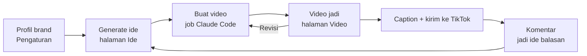

# Cara pakai

Studio Konten adalah dashboard web untuk mengelola konten TikTok sebuah brand dari satu tempat. Pekerjaan video dikerjakan **Claude Code** di komputer, sedangkan dashboard dipakai untuk memberi perintah dan menerima hasil.

- **Di komputer:** http://localhost:4321 (tanpa PIN)
- **Dari HP:** alamat di **Pengaturan › Akses HP**, lalu PIN dari `studio/data/pin.txt` (cookie berlaku 90 hari)

## Alur kerja



1. Isi **Profil brand** dan pilih **Model AI** di Pengaturan.
2. **Generate ide** di halaman Ide, atau tulis ide sendiri.
3. **Buat video** dari ide. Job masuk **Antrian**; Claude Code menulis naskah, membuat suara, menyusun scene, merender, dan menjalankan QA.
4. Video jadi muncul di halaman **Video** dengan caption, hashtag, dan badge QA. Minta **Revisi** kalau perlu.
5. Salin caption atau kirim ke draf TikTok, lalu tempel link TikTok-nya supaya komentar bisa dipantau.

## Beranda

Ringkasan: ide siap, job diproses, video siap upload, video sudah diupload; log job yang sedang berjalan; video terbaru.

## Ide

Bank ide konten dalam bentuk daftar ringkas. Klik baris untuk membuka detail (poin isi, catatan produksi, caption + hashtag).

| Fitur | Keterangan |
|---|---|
| Tab status | Semua · Ide · Diproduksi · Selesai · Diupload · Dibuang |
| Cari, filter pilar, urutan | Mencari di judul, hook, poin, catatan, caption, hashtag, atau nomor (`#52`) |
| Pilih banyak | Jadikan Ide, Buang, atau Hapus sekaligus |
| **Generate ide** | AI membuat 1–10 ide. **Campur** (bawaan): pilar teknologi umum bergiliran, pilar brand paling banyak 1 dari 5. Bisa diberi tema. Tombol menghitung detik selama menunggu; model yang "berpikir" dulu (mis. Claude Fable) bisa butuh beberapa menit. |
| **Tulis ide sendiri** | Simpan ide tanpa AI |
| **Caption** | AI menulis caption 2–4 baris dan tepat 5 hashtag |

**Pilar konten:** Setting & tips perangkat, AI & tools, Dunia teknologi, Keamanan digital, Produktivitas & life hack, Edukasi internet, dan pilar brand. Hanya pilar brand yang boleh promosi; ide lain tetap dibawakan karakter brand dengan penutup ajakan follow/save. Setiap ide juga diberi **bentuk** (tutorial, mitos vs fakta, daftar, perbandingan, explainer, sketsa, tanya-jawab, kuis, dll.). Ide yang bergantung pada fitur aplikasi, versi OS, atau berita diberi label **Perlu riset**, dan job videonya wajib mengecek ke web dulu.

## Buat video

| Kolom | Pilihan |
|---|---|
| Judul / ide | Terisi dari ide |
| Pilar konten | Otomatis dari judul, atau pilih |
| Jenis video | Edukasi / tips, Promosi, Cerita lapangan, Klip dari video (memotong rekaman yang diupload) |
| Brief | Poin wajib, gaya, larangan, karakter |
| Target durasi | 20–90 detik, atau **Bebas** (panjang mengikuti isi) |
| Mode sampul | Otomatis dari pilar, atau Hitungan / Tips / Aman / Brand |
| Lampirkan media | Foto/rekaman dari halaman Media |
| Sekalian versi YouTube 16:9 | Setelah versi TikTok jadi, job versi YouTube diantrikan otomatis |

**Kirim ke Claude Code** memasukkan job ke antrian. Job berjalan satu per satu; satu video biasanya 20–40 menit (naskah, suara, scene, 1–3 kali render 60 fps, QA).

## Video

Tab Semua · Siap upload · Diupload, dan filter format TikTok 9:16 / YouTube 16:9. Setiap kartu:

- Pemutar, judul, format, durasi.
- **Badge QA** dari `npm run qa`: Lolos, catatan (⚠), atau gagal (✗). Klik untuk melihat tiap pemeriksaan dan still tiap scene.
- **Pratinjau grid profil**: sampul video ini di antara sampul video lain, dipotong 3:4 seperti grid profil TikTok.
- **Salin caption**, edit caption/hashtag, **Caption ulang**.
- **Revisi video**: tulis yang mau diubah, boleh tambah media. Revisi melanjutkan sesi Claude Code yang membuat video itu.
- **Buat versi YouTube**: menata ulang scene ke 1920×1080 dan memakai ulang suara yang sama (tanpa kuota suara).
- **Link TikTok**: tempel link video yang sudah tayang; komentarnya akan muncul di halaman Komentar.
- **TikTok** (kalau akun tersambung): kirim ke draf/inbox atau posting langsung (posting langsung butuh audit TikTok).
- **Unduh**, **Tandai diupload**, **Hapus** (folder proyek dan mp4 ke Trash).

## Komentar

Komentar terbaru dari video TikTok yang sudah diberi link, dibaca dari endpoint web publik TikTok tanpa login. Filter **Belum dibalas** / Semua dan rentang 7 hari / 30 hari / Semua. **Jadikan ide video balasan** membuat ide tanya-jawab dari komentar itu (sampulnya memakai kartu komentar). Membalas tetap dari aplikasi TikTok.

Dari Terminal: `node scripts/tiktok-comments.mjs <id atau link> [--days=7] [--belum] [--json]`.

## Media

- **Upload foto/video** (maks 30 file sekaligus, 4 GB per file). Beri catatan isi supaya Claude tahu kapan memakainya.
- **Gambar anime (AI)**, butuh `DASHSCOPE_API_KEY`:
  - **Karakter:** karakter brand (dari `brand/brand.mjs`), 17 pose, seluruh/setengah badan, 1–4 gambar sekaligus.
  - **Variasi:** pose baru dari gambar yang ada; wajah dan seragam tetap.
  - **Bebas:** latar, benda, atau adegan, dengan opsi latar transparan.
- Per gambar karakter: **Mulut bicara** membuat 3 frame mulut (tutup, setengah, buka) untuk animasi bicara.

Karakter anime transparan otomatis dikirim ke setiap job video.

## Edit video

Untuk rekaman sendiri (video dari HP/kamera). Claude memotong, memberi subtitle per kata (Whisper lokal), judul hook, ikon, ajakan follow, efek suara, dan zoom halus sesuai pilihan.

1. Upload rekaman (dan foto/logo opsional).
2. Tulis instruksi, centang **Pilihan cepat**, pilih format (9:16, 16:9, atau ikuti video asli) dan durasi.
3. **Kirim ke Claude Code**. Hasilnya masuk ke halaman Video.

## Antrian

Daftar job dengan status Antri · Berjalan · Selesai · Gagal · Batal. **Log** menampilkan langkah Claude Code secara langsung; **Batalkan** menghentikan job.

## Pengaturan

| Tab | Isi |
|---|---|
| **Profil brand** | Sumber fakta untuk semua ide, caption, dan video. AI hanya boleh memakai fakta yang tertulis di sini. Awalnya diisi dari `brand/profile.md`. |
| **Model AI** | Kunci router (Base URL + API key; kosong = dari `.env`) dan Anthropic (API key). Daftar model untuk ide & caption: tiap baris pilih penyedia lalu model dari dropdown; dicoba berurutan (Utama, lalu Cadangan). Key hanya bisa ditulis, tidak pernah dikirim balik ke browser. |
| **Job video & suara** | Kuota suara Gemini hari ini (+ **Cek koneksi**), model Claude Code untuk video (kosong = bawaan), batas suara per hari, izin Claude Code saat jalan otomatis, **Tes koneksi Claude Code** |
| **TikTok** | Status akun, Login/Putuskan, Client Key/Secret, Redirect URI, scope |
| **Akses HP** | Alamat LAN dengan tombol Salin |

## Tanpa dashboard (Terminal)

Semua langkah video juga bisa dijalankan sendiri. Dari folder repo:

```bash
node scripts/new-project.mjs nama-topik     # proyek baru dari template + file brand
cd nama-topik
```

Lalu dari folder proyek:

```bash
npm run studio                 # Remotion Studio (pratinjau interaktif)
npm run vo                     # suara Gemini TTS: 1 request per suara, dipotong per scene
npm run vo:reuse               # potong ulang take yang tersimpan, tanpa kuota
npm run check                  # transkripsi tiap potongan suara (4 sekaligus, ada cache)
npm run check:crop             # karakter terpotong di pinggir?
npm run render                 # → ../output/<folder>.mp4, keras suara dinormalkan ke −14 LUFS
npm run qa -- --durasi=60      # pemeriksaan sebelum kirim
npm run render:yt              # versi YouTube 16:9 (butuh src/scenesWide.tsx)
```

Atau minta langsung ke Claude Code di Terminal: "buatkan video TikTok tentang …" (skill `video-tiktok` terpakai otomatis).
